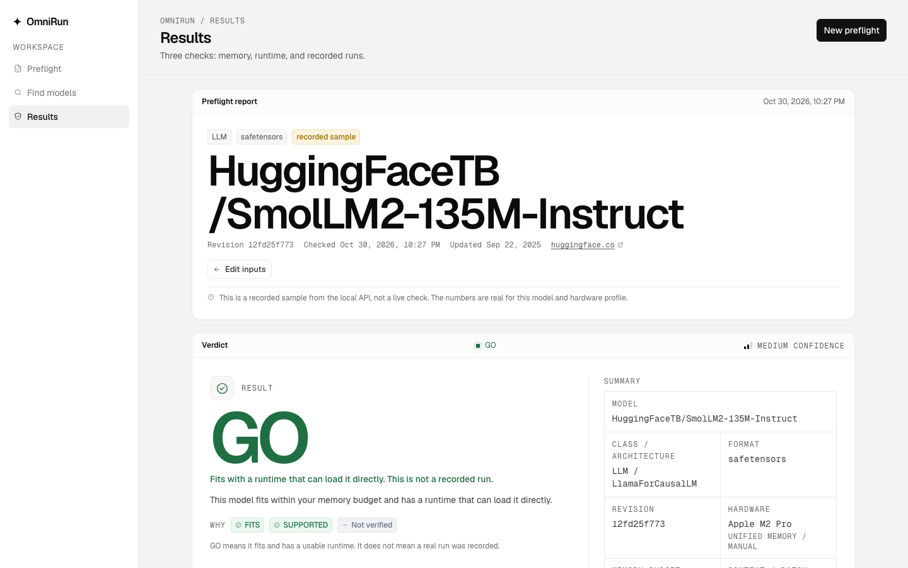
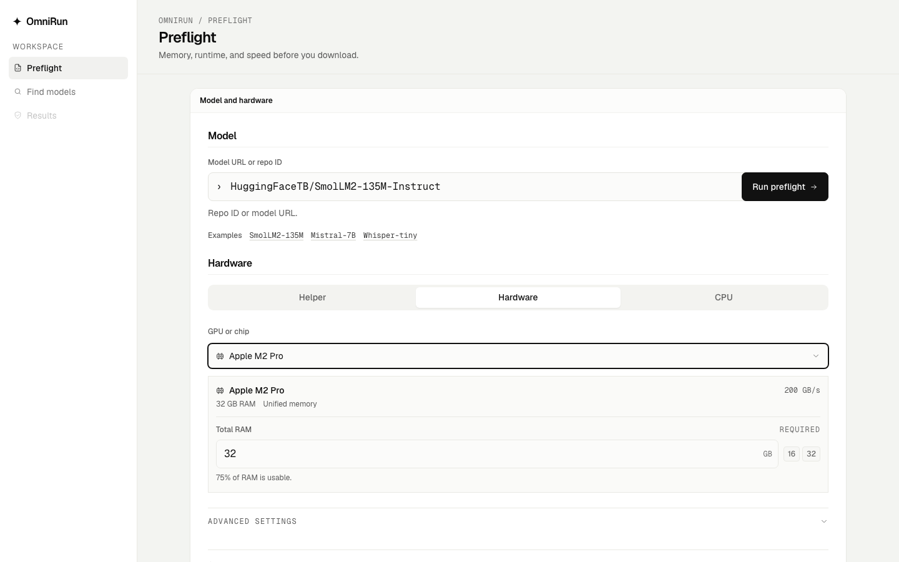
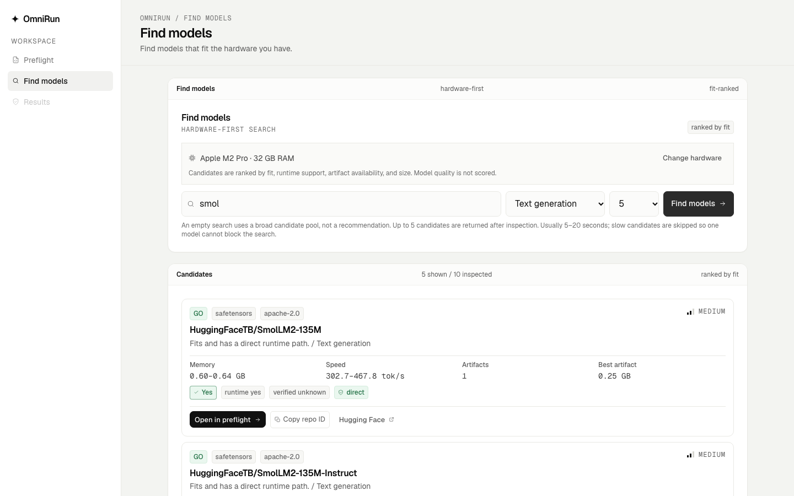
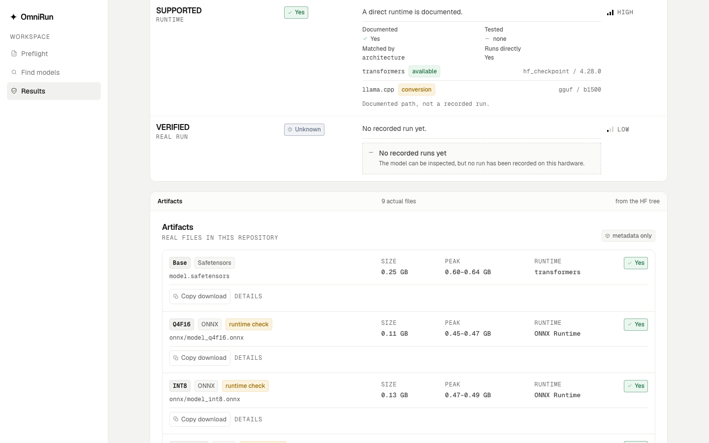
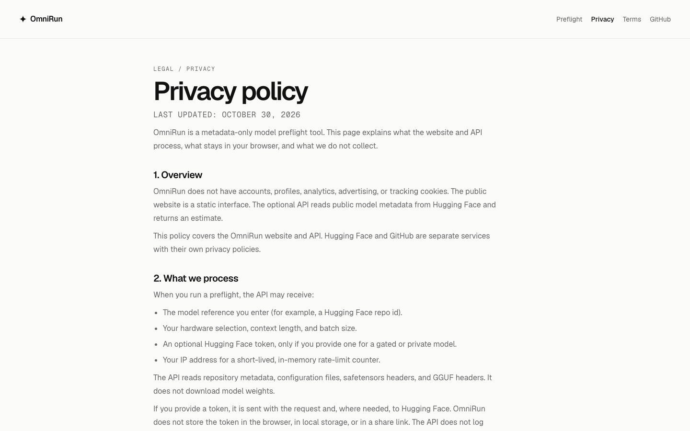
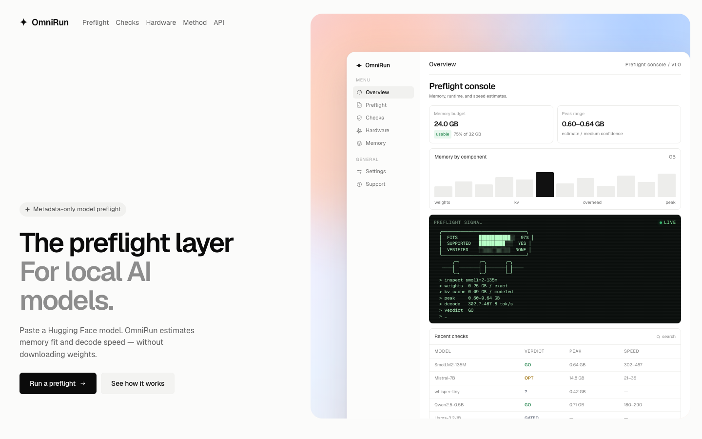

<div align="center">

# OmniRun

**The preflight layer for local AI models.**

Paste a Hugging Face model. OmniRun estimates memory fit, runtime support, and decode speed before you download the weights.

[](https://omnirun.enoch.et/)
[](https://omnirun.enoch.et/?sample=1)
[](https://github.com/Henok-Tekeba/omnirun)
[](LICENSE)

[](pyproject.toml)
[](https://fastapi.tiangolo.com/)
[](https://react.dev/)
[](web/package.json)

**Live:** [omnirun.enoch.et](https://omnirun.enoch.et/) · **Sample:** [recorded report](https://omnirun.enoch.et/?sample=1) · **Local live checks:** [quick start](#local-setup)

</div>

<p align="center">
  <a href="https://omnirun.enoch.et/?sample=1">
    
  </a>
</p>

<p align="center"><sub>Recorded sample report · SmolLM2-135M-Instruct · Apple M2 Pro · 32 GB RAM</sub></p>

> The public GitHub Pages build is a static product preview. Live preflights and model discovery require the FastAPI service. Run it locally with `npm run dev`, or connect a hosted API using the [deployment guide](docs/deployment.md).

## Why OmniRun

A model card can tell you the parameter count, license, and architecture. It usually does not tell you whether the weights fit your machine, which runtime can actually load the artifact, or how much headroom remains at your context and batch size.

Downloading multi-gigabyte weights just to discover they do not fit is slow, expensive, and often unnecessary. OmniRun reads model metadata and safetensors/GGUF headers over HTTP range requests, then returns a versioned report with explicit assumptions.

The promise is not “this model works.” It is a preflight: keep **FITS**, **SUPPORTED**, and **VERIFIED** separate, show the real repository artifacts, and make the next decision clear before you commit disk, memory, or time.

## A day with OmniRun

1. **Choose the target machine.** Pick a curated GPU or chip from the hardware dropdown, run the local helper for a measured profile, or use the conservative CPU-only mode.
2. **Paste a model.** Use a Hugging Face repo ID or model URL, then set context and batch if the defaults are not right.
3. **Run the preflight.** OmniRun resolves the model revision, inspects metadata and headers, and returns memory, runtime, speed, and artifact evidence.
4. **Read the claims separately.** `FITS` answers memory. `SUPPORTED` answers runtime. `VERIFIED` answers whether a real run has been recorded. `GO` never means verified.
5. **Choose the next action.** Inspect the artifact shelf, use what-if planning to find a fitting context or batch, share the report URL, or open the hardware-first model finder.

## Features

- **Three independent claims.** FITS, SUPPORTED, and VERIFIED are never collapsed into a single “works” answer. You can see exactly which claim is missing and why.
- **No weight downloads.** OmniRun reads repository metadata, configuration, safetensors headers, and GGUF headers. It never downloads tensor payloads or unpickles model files.
- **Hardware-first model finder.** Start with the machine you have. Candidates are ranked by fit, runtime support, artifact availability, and size — model quality is not scored.
- **Real artifact shelf.** See the actual files in the repository, their format, quantization, size, runtime path, and whether the weights fit.
- **What-if planning.** Explore context length, batch size, free memory, and quantization alternatives, including the maximum context and batch that fit.
- **Measured hardware helper.** Run a small local helper to measure CPU/unified-memory bandwidth and produce a self-reported OR1 hardware code.
- **Shareable reports.** The URL carries the model, hardware, context, and batch. It never carries your Hugging Face token.
- **Responsive, accessible interface.** 16px base type, a rem-based scale, 44px touch targets, WCAG AA contrast, reduced-motion support, and layouts tested down to 320px.

## Design principles

- **Claims stay separate.** A model can fit but lack a runtime path; it can be supported but unverified. The UI should not flatten those differences.
- **Unknown is a first-class result.** Missing configuration, unsupported architectures, and insufficient hardware data produce `UNKNOWN`, not a confident guess.
- **Exact math is not padded.** When the weight bytes and KV formula are exact, the memory range is exact. Uncertainty is represented in confidence, assumptions, and genuinely variable components.
- **Metadata is the boundary.** No tensor payloads, no pickle parsing, no weight redistribution. The API’s job is to inspect metadata safely.
- **Every number is traceable.** Estimates map to an input, a named constant, or an assumption repeated in the response and in [docs/methodology.md](docs/methodology.md).
- **Single device, stated plainly.** v1 does not pretend to model multi-GPU, offload, or distributed serving. The limitation is part of the product contract.

## Product screens

All screenshots use public demo data and a **1440 × 900** viewport. No user data or credentials are shown.

| Preflight | Hardware-first finder |
| --- | --- |
|  |  |
| **Artifact and claim detail** | **Privacy and legal surface** |
|  |  |

<p align="center">
  <a href="https://omnirun.enoch.et/">
    
  </a>
</p>

<p align="center"><sub>Landing page · static product preview</sub></p>

There are no settings, account, or onboarding screens in v1. Hardware preferences live in the Preflight form and are remembered locally; OmniRun has no accounts.

## Auth model

OmniRun is **anonymous by design**. There is no sign-up, login, session store, password database, or user profile.

```text
┌─────────────────────────────┐
│ Browser                     │
│ no account · no session     │
│ optional HF token in body   │
└──────────────┬──────────────┘
               │ POST /check
               ▼
┌─────────────────────────────┐
│ FastAPI                     │
│ stateless request handling  │
│ no password store           │
└──────────────┬──────────────┘
               │ request-scoped token
               ▼
┌─────────────────────────────┐
│ Hugging Face                │
│ metadata + range requests   │
└─────────────────────────────┘
```

- **Account creation:** not applicable. There are no accounts.
- **Existing accounts:** not applicable. There is no login or account recovery flow.
- **Sessions:** no server-side sessions and no auth cookies. The browser stores only the hardware preference and cookie-notice choice in `localStorage`.
- **Password handling:** not applicable. OmniRun does not accept or store passwords.
- **Data isolation:** there are no user records to isolate. The result cache key includes the model, hardware, context, batch, schema, support-matrix version, and a one-way hash of an optional token scope. Anonymous and token-scoped results do not share cache entries.
- **Hugging Face tokens:** optional and request-scoped. A token is used only for that request chain, is never echoed in the response, never logged, and never included in a share URL.

If you need accounts later, add them as a separate product surface. Do not treat the current anonymous API as an identity system.

## Architecture

```text
┌──────────────────────────────────────────────────────────────┐
│ Browser                                                      │
│ React 19 · Vite · TypeScript · accessible responsive UI      │
└──────────────────────────────┬───────────────────────────────┘
                               │ /api in local dev
                               │ VITE_API_BASE_URL in production
                               ▼
┌──────────────────────────────────────────────────────────────┐
│ FastAPI · api/                                               │
│ request validation · CORS · rate limiting · result cache    │
│                                                              │
│ core/                                                        │
│ model inspection · memory estimate · KV math · speed ·      │
│ support matrix · artifacts · verdict · verified claims      │
│                                                              │
│ data/                                                        │
│ devices.yaml · support_matrix.yaml · verified_runs.json     │
└──────────────────────────────┬───────────────────────────────┘
                               │ metadata + HTTP range requests
                               ▼
┌──────────────────────────────────────────────────────────────┐
│ Hugging Face                                                 │
│ repository metadata · config.json · safetensors headers ·    │
│ GGUF headers                                                 │
└──────────────────────────────────────────────────────────────┘
```

### Local vs production

| Layer | Local | Production |
| --- | --- | --- |
| Frontend | Vite at `http://localhost:5173` | GitHub Pages static build at `https://omnirun.enoch.et/` |
| API | Uvicorn at `http://127.0.0.1:8000` | Vercel FastAPI, Render Docker, or any Python host |
| Data | Source-controlled `data/` files | Same `data/` files bundled with the API |
| Persistence | `~/.cache/omnirun` filesystem cache | Ephemeral cache, e.g. `/tmp/omnirun-cache` |
| Database | None | None |
| Auth | None | None |

### API surface

| Method | Path | Purpose |
| --- | --- | --- |
| `POST` | `/check` | Full preflight report |
| `POST` | `/find` | Hardware-first candidate discovery |
| `GET` | `/devices` | Curated manual hardware profiles |
| `GET` | `/schema` | Versioned request/response schemas |
| `GET` | `/health` | Service health |
| `GET` | `/docs` | Generated OpenAPI documentation |

The contract is versioned as `schema_version: "1.0"`. All JSON memory values are bytes; bandwidth is decimal GB/s.

## Stack

| Layer | Technology | Notes |
| --- | --- | --- |
| Frontend | React 19.3, TypeScript 5.9, Vite 8.3 | Static SPA, no UI framework beyond Tailwind CSS 4.3 |
| API | Python 3.11–3.13, FastAPI 0.115+, Pydantic 2, Uvicorn | Versioned JSON contract, OpenAPI at `/docs` |
| Inspection | `huggingface-hub`, `httpx`, safetensors/GGUF header readers | Metadata and range requests only |
| Modeling | Python modules in `core/` | Memory, KV cache, decode speed, support, verdict, artifacts |
| Data | YAML + JSON | Curated devices, support matrix, verified-run registry |
| Persistence | Filesystem cache | No database, no server-side user records |
| Auth | None | Anonymous, no accounts or sessions |
| Testing | pytest 8+, Ruff, Playwright 1.64 | 152 backend tests and 5 browser tests at last verification |
| Frontend deploy | GitHub Pages | Static preview; custom domain |
| API deploy | Vercel, Render, Docker | Configuration is included; a public API host is not configured yet |

## Local setup

Requirements: **Python 3.11–3.13**, **uv**, **Node.js 20+**, and **npm**.

```bash
git clone https://github.com/Henok-Tekeba/omnirun.git
cd omnirun
uv sync
npm run setup
npm run dev
```

The dev runner starts both services:

```text
Web   http://localhost:5173
API   http://127.0.0.1:8000
Docs  http://127.0.0.1:8000/docs
```

`Ctrl+C` stops both. The web dev server proxies `/api` to the local FastAPI service. Public model checks do not require an API key or account.

Production frontend build:

```bash
npm run build
```

The first run may download Python dependencies and the Playwright Chromium browser. If you only need the static preview, `npm run build` is enough; live checks require the API.

## Environment variables

No environment variables are required for public model checks in local development. The defaults proxy the frontend to `127.0.0.1:8000`.

### Frontend

```dotenv
# web/.env.local — optional
VITE_API_BASE_URL=
VITE_BASE_PATH=/
```

| Variable | Required | Default | Purpose |
| --- | --- | --- | --- |
| `VITE_API_BASE_URL` | Production only | empty | API origin, without `/api`. Empty in a production build means static preview mode. |
| `VITE_BASE_PATH` | No | `/` | Vite base path. Use `/` for a custom domain or `/repo/` for project Pages. |
| `OMNIRUN_API_URL` | No | `http://127.0.0.1:8000` | Dev-only Vite proxy target. |

### API

```dotenv
# .env — optional; never commit it
OMNIRUN_CORS_ORIGINS=
OMNIRUN_TRUST_PROXY_HEADERS=false
OMNIRUN_CACHE_DIR=
OMNIRUN_DATA_DIR=
OMNIRUN_HF_ENDPOINT=https://huggingface.co
OMNIRUN_RATE_LIMIT_PER_MINUTE=30
OMNIRUN_RATE_LIMIT_BURST=10
OMNIRUN_CHECK_TIMEOUT_SECONDS=30
OMNIRUN_FIND_TIMEOUT_SECONDS=30
OMNIRUN_HF_MAX_ATTEMPTS=3
OMNIRUN_HF_MAX_CONCURRENT=4
OMNIRUN_MAX_CONCURRENT_CHECKS=8
OMNIRUN_RESULT_CACHE_TTL_SECONDS=600
OMNIRUN_ENABLE_RESULT_CACHE=true
```

| Variable | Required | Default | Purpose |
| --- | --- | --- | --- |
| `OMNIRUN_CORS_ORIGINS` | Production | empty | Comma-separated allowed frontend origins. Empty disables the CORS middleware. |
| `OMNIRUN_TRUST_PROXY_HEADERS` | No | `false` | Trust `X-Forwarded-For` for rate limiting. Enable only behind a proxy that overwrites the header. |
| `OMNIRUN_CACHE_DIR` | No | `~/.cache/omnirun` | Filesystem cache for metadata and results. Use an ephemeral path on serverless hosts. |
| `OMNIRUN_DATA_DIR` | No | repository `data/` | Device table, support matrix, and verified-run registry. |
| `OMNIRUN_HF_ENDPOINT` | No | `https://huggingface.co` | Hugging Face endpoint. |
| `OMNIRUN_RATE_LIMIT_PER_MINUTE` | No | `30` | Per-client-IP request budget. |
| `OMNIRUN_RATE_LIMIT_BURST` | No | `10` | Token-bucket burst size. |
| `OMNIRUN_CHECK_TIMEOUT_SECONDS` | No | `30` | Whole `/check` deadline. |
| `OMNIRUN_FIND_TIMEOUT_SECONDS` | No | `30` | Whole `/find` deadline. |
| `OMNIRUN_HF_MAX_ATTEMPTS` | No | `3` | Hugging Face retry attempts for retryable failures. |
| `OMNIRUN_HF_MAX_CONCURRENT` | No | `4` | Concurrent Hugging Face requests. |
| `OMNIRUN_MAX_CONCURRENT_CHECKS` | No | `8` | Global check/find concurrency cap. |
| `OMNIRUN_RESULT_CACHE_TTL_SECONDS` | No | `600` | Result cache lifetime. `0` disables new cache writes; set `OMNIRUN_ENABLE_RESULT_CACHE=false` to disable cache reads too. |
| `OMNIRUN_ENABLE_RESULT_CACHE` | No | `true` | Enable the result cache. |

Do not put Hugging Face tokens, API keys, or service credentials in this file. Tokens for gated/private models are supplied per request and are never persisted.

## Database setup

There is **no database**. No migrations, seeds, ORM, or `DATABASE_URL`.

The durable data is source-controlled:

```text
data/devices.yaml            curated hardware profiles
data/support_matrix.yaml     architecture/runtime support paths
data/verified_runs.json      recorded-run registry (empty in v1)
```

The only runtime state is a filesystem cache:

```bash
# Inspect the source-controlled data
ls data

# Clear only the disposable cache
rm -rf "${OMNIRUN_CACHE_DIR:-$HOME/.cache/omnirun}"
```

**Warnings:** do not delete `data/` to reset the app. It contains the curated profiles and support matrix. Deleting the cache is safe; it only forces fresh Hugging Face metadata requests.

### Fresh-database alternative

There is no database to recreate. A clean checkout plus an empty cache is the fresh-install path:

```bash
git pull
uv sync
rm -rf "${OMNIRUN_CACHE_DIR:-$HOME/.cache/omnirun}"
npm run dev
```

## OAuth/provider setup

OmniRun does **not use OAuth**. There are no providers, redirect URIs, callback routes, client IDs, or client secrets.

| Item | Value |
| --- | --- |
| OAuth provider | None |
| Redirect URI | None |
| Scopes | None |
| Callback route | None |
| Service credentials | None |

The optional Hugging Face token is a per-request bearer token for gated/private repositories. It is not an OAuth flow and has no callback. It is never stored in the browser, local storage, a share link, or API logs.

If you add authentication later, keep provider secrets server-side and never expose them through `VITE_*` variables.

## Testing

Run the same checks used for this README:

```bash
# Backend: 152 tests, recorded Hugging Face fixtures, no network required
uv run pytest

# Lint
uv run ruff check .

# Frontend type-check + production build
npm run build

# Browser tests: starts/reuses the local API and Vite server
npm run setup
npm run test:e2e
```

What each layer covers:

- **Backend tests** exercise request validation, revision pinning, metadata inspection, safetensors/GGUF parsing, memory and KV math, decode-speed ranges, support claims, verdict mapping, artifacts, caching, rate limiting, CORS, and error envelopes.
- **Frontend build** runs `tsc --noEmit` before Vite production bundling.
- **Playwright tests** cover the preflight happy path, ASR `UNKNOWN` handling, the hardware-first finder, invalid input, cookie consent, mobile navigation, and legal pages.

Last verified on this checkout: **152 backend tests passed**, **Ruff clean**, **frontend build passed**, **5 Playwright tests passed**.

## Deployment

### Current state

The frontend is deployed to GitHub Pages at [omnirun.enoch.et](https://omnirun.enoch.et/). The public build is a **static preview**: it shows the full product surface and a recorded sample report, but live preflights require the API.

The repository contains a ready FastAPI entrypoint (`app.py`), a Vercel configuration (`vercel.json`), a production Dockerfile, and a Render blueprint (`render.yaml`). No public API host is configured yet.

### GitHub Pages

The workflow is [`.github/workflows/deploy-pages.yml`](.github/workflows/deploy-pages.yml). It builds `web/` with:

```text
VITE_BASE_PATH=/
VITE_API_BASE_URL=${{ vars.VITE_API_BASE_URL }}
```

If `VITE_API_BASE_URL` is unset, the build stays in static-preview mode.

### Vercel

```bash
npx vercel login
npx vercel --prod
```

Set these production environment variables in Vercel:

```text
OMNIRUN_CORS_ORIGINS=https://omnirun.enoch.et,https://henok-tekeba.github.io
OMNIRUN_CACHE_DIR=/tmp/omnirun-cache
OMNIRUN_TRUST_PROXY_HEADERS=true
```

Vercel loads the ASGI app from `app.py`. Vercel Hobby is for personal, non-commercial use; check the current plan terms before production use.

### Render

[`render.yaml`](render.yaml) defines a Docker web service named `omnirun-api` with a `/health` check. Apply the blueprint, then set the frontend API variable to the service origin.

Free Render services sleep after inactivity. The [keepalive workflow](.github/workflows/keepalive.yml) pings `/health` every 10 minutes when `VITE_API_BASE_URL` is configured.

### Docker

```bash
docker build -t omnirun-api .
docker run --rm -p 8000:8000 \
  -e OMNIRUN_CORS_ORIGINS=https://omnirun.enoch.et,https://henok-tekeba.github.io \
  -e OMNIRUN_TRUST_PROXY_HEADERS=true \
  omnirun-api
```

### Wire the frontend to the API

Set the GitHub Actions variable to the API origin **without** `/api`:

```bash
gh variable set VITE_API_BASE_URL \
  --repo Henok-Tekeba/omnirun \
  --body "https://<api-origin>"

gh workflow run deploy-pages.yml --repo Henok-Tekeba/omnirun
```

### Production command

```bash
VITE_BASE_PATH=/ VITE_API_BASE_URL="https://<api-origin>" npm run build
uv run uvicorn api.main:app --host 0.0.0.0 --port 8000
```

CORS origins must match the deployed frontend exactly. If the API is hosted on a different origin, set `OMNIRUN_CORS_ORIGINS` and rebuild the frontend with the new `VITE_API_BASE_URL`.

Cloudflare Pages is not configured in this repository. If you choose it, build `web/` with `VITE_BASE_PATH=/`, set `VITE_API_BASE_URL`, and host the FastAPI service separately.

See [docs/deployment.md](docs/deployment.md) for provider-specific details and verification commands.

## Security notes

- **No accounts or sessions.** There are no passwords, auth cookies, password hashes, or user profiles to protect.
- **No service keys in the frontend.** The Vite bundle contains only public configuration. Never expose a Hugging Face token or provider secret through a `VITE_*` variable.
- **Tokens are request-scoped.** An optional Hugging Face token is used only for that request chain, is never logged, is never stored in the result, and is excluded from share URLs. Cache keys use a one-way token-scope hash.
- **Metadata only.** OmniRun does not download tensor payloads or unpickle `.bin` files. It reads metadata, configuration, safetensors headers, and GGUF headers over range requests.
- **Rate limiting is per process.** The in-process token bucket is not a distributed limiter. Multi-worker deployments need a shared limiter.
- **CORS is an allowlist.** Set `OMNIRUN_CORS_ORIGINS` to the exact frontend origins. Do not use a wildcard for production.
- **Proxy trust is explicit.** `OMNIRUN_TRUST_PROXY_HEADERS=true` is safe only behind a trusted reverse proxy that overwrites `X-Forwarded-For`.
- **No analytics or tracking cookies.** The site uses local storage only for the hardware preference and cookie-notice choice.
- **Estimates are not guarantees.** A `GO` result means the model fits and has a documented runtime path. It does not mean the model was verified on your machine.

Report vulnerabilities through [GitHub private vulnerability reporting](https://github.com/Henok-Tekeba/omnirun/security/advisories/new). See [SECURITY.md](SECURITY.md) for scope and reporting guidance.

## Project structure

```text
.
├── api/                      FastAPI app, schemas, rate limiting, service assembly
│   ├── main.py               /check, /find, /devices, /schema, /health
│   ├── schemas.py            Versioned Pydantic contract
│   └── settings.py           OMNIRUN_* configuration
├── core/                     Inspection, memory/speed math, support, artifacts, verdict
├── data/                     Curated devices, support matrix, verified-run registry
├── helper/                   Local hardware measurement helper
├── web/                      React + Vite + TypeScript frontend
│   ├── src/
│   │   ├── components/       Landing, dashboard, preflight, result, finder, legal
│   │   ├── demo/             Recorded sample report and curated device list
│   │   ├── hooks/            API state hooks
│   │   └── lib/              Form state, query state, formatting, consent
│   ├── tests/                Playwright browser tests
│   └── .env.example          Frontend environment template
├── tests/                    Offline pytest suite and Hugging Face fixtures
├── docs/
│   ├── deployment.md         Provider deployment steps
│   ├── methodology.md        Modeling assumptions and limitations
│   └── screenshots/          README product screenshots
├── scripts/                  Dev runner, OpenAPI type generation, fixture recorder
├── app.py                    Vercel ASGI entrypoint
├── Dockerfile                Production API image
├── render.yaml               Render blueprint
├── vercel.json               Vercel function and bundle configuration
├── LICENSE                   MIT
└── README.md
```

## Roadmap and status

| Area | Status |
| --- | --- |
| Public frontend | Live static preview at [omnirun.enoch.et](https://omnirun.enoch.et/) |
| Hosted API | Configuration ready; not deployed |
| Live preflights | Available locally with `npm run dev` |
| Accounts | Not in v1 |
| Database | None |
| Verified runs | Registry is empty by design |
| Backend tests | 152 passing |
| Browser tests | 5 passing |
| Device scope | Single device only |

**Shipped**

- Metadata-only model inspection with revision pinning.
- Separate FITS, SUPPORTED, and VERIFIED claims.
- Memory, KV-cache, and decode-speed estimates with explicit assumptions.
- Hardware-first finder, artifact shelf, and what-if planning.
- Curated 34-device hardware table and measured helper input.
- Responsive product UI, legal pages, cookie notice, and static sample report.
- Vercel, Render, and Docker deployment configuration.

**Next, in priority order**

1. Host the API and set `VITE_API_BASE_URL` so the public site can run live checks.
2. Add a verified-run registry with hardware fingerprints, runtime versions, commands, and dates.
3. Add saved-report comparison and local report history.
4. Add a CLI and GitHub Action with `--fail-on` support for CI preflight checks.
5. Add runtime deployment recipes for llama.cpp, transformers, vLLM, Ollama, and MLX.
6. Add a Hugging Face browser extension for one-click preflight from a model page.

**Out of scope for v1:** multi-GPU, offload, distributed serving, prefill/time-to-first-token estimation, quality rankings, weight hosting, and accounts.

## Repository, source, and license

- **Source:** [github.com/Henok-Tekeba/omnirun](https://github.com/Henok-Tekeba/omnirun)
- **Issues:** [github.com/Henok-Tekeba/omnirun/issues](https://github.com/Henok-Tekeba/omnirun/issues)
- **Security:** [SECURITY.md](SECURITY.md)
- **Methodology:** [docs/methodology.md](docs/methodology.md)
- **Deployment:** [docs/deployment.md](docs/deployment.md)

OmniRun is released under the [MIT License](LICENSE). Model metadata and artifacts belong to their respective repository owners. OmniRun does not redistribute model weights.

Estimates are decision support, not guarantees. Always validate a model on the hardware and runtime you intend to use.
